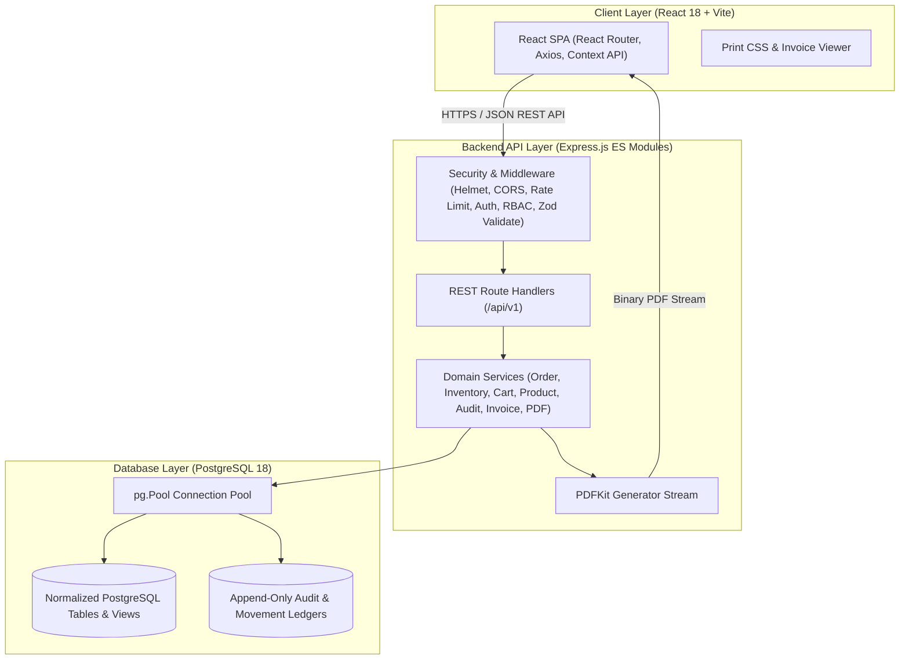
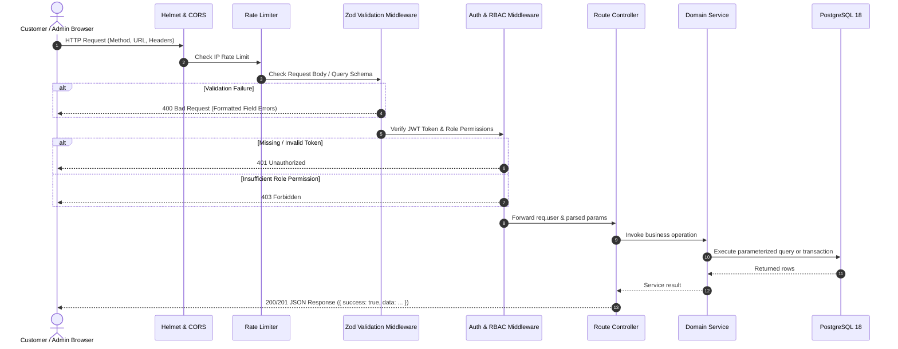
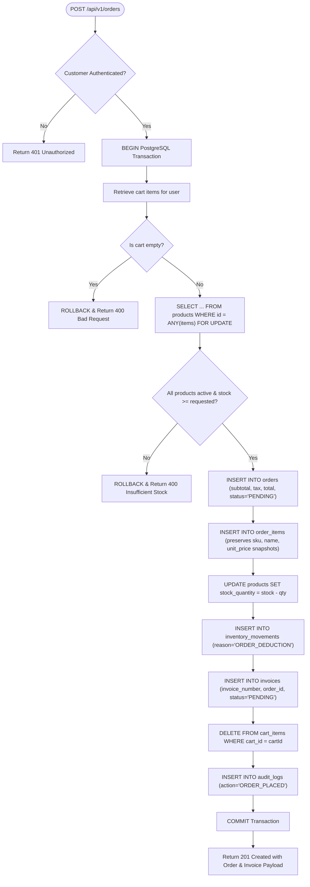

# System Architecture & Technical Design
## Arrowstack Internship — Project 1: B2B Order Management Platform

---

## 1. Architecture Overview

The system is architected as a **Modular Full-Stack Monolith**, segregating concerns into a responsive Single Page Application (SPA) frontend, an Express.js REST API layer with domain services, and a relational PostgreSQL database.

---

## 2. Request Processing & Security Pipeline

Each incoming HTTP request traverses a hardened middleware pipeline:

---

## 3. Order Placement & Transaction Concurrency Flow

To guarantee zero overselling when multiple buyers place simultaneous orders targeting shared inventory, the order placement workflow employs PostgreSQL row-level locks within a strict ACID transaction:

---

## 4. Key Architectural Trade-offs & Decisions

1. **Modular Monolith vs Microservices**:
   - *Decision*: Adopted a single modular Express monolith instead of decoupled microservices.
   - *Rationale*: For an internship project, a monolith simplifies local evaluation, deterministic migration testing, atomic relational transactions, and CI/CD without the operational overhead of service meshes or distributed transactions.

2. **Server-Side Price Calculation**:
   - *Decision*: Client-supplied prices and subtotals are completely ignored. All line prices, taxes, and totals are fetched authoritatively from PostgreSQL.
   - *Rationale*: Eliminates client-side tampering vulnerabilities where a user could manipulate the browser DOM or Axios payload to purchase goods at arbitrary rates.

3. **Row-Level Locking (`SELECT FOR UPDATE`)**:
   - *Decision*: Product records are locked exclusively during cart checkout.
   - *Rationale*: Eliminates race conditions in high-demand catalog scenarios where two buyers attempt to purchase the final remaining units concurrently.
