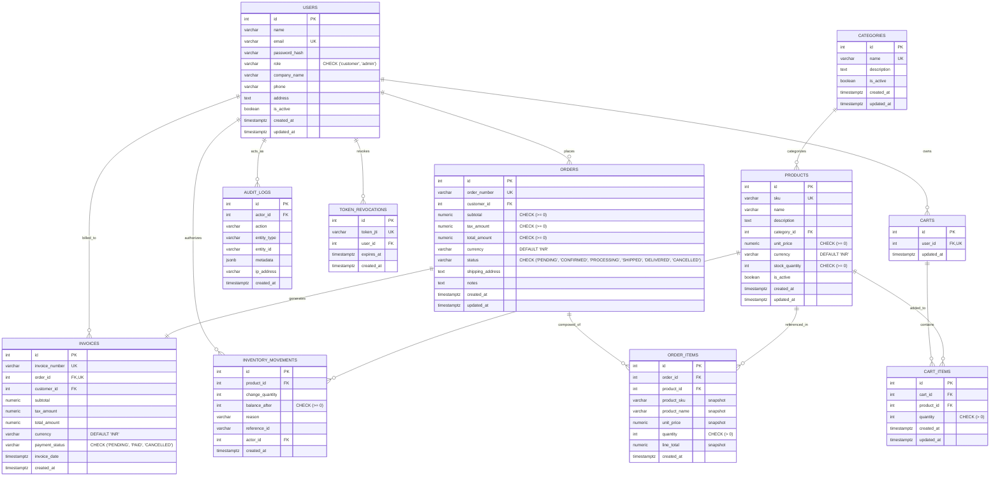

# Relational Database Design & Schema Specification
## Arrowstack Internship — Project 1: B2B Order Management Platform

---

## 1. Entity-Relationship Diagram (ERD)



---

## 2. Table Structures & Constraint Justifications

### 2.1 Numeric Precision for Financial Amounts
- **Type**: `NUMERIC(12, 2)` for `unit_price`, `subtotal`, `tax_amount`, and `total_amount`.
- **Justification**: Eliminates binary floating-point rounding errors (e.g., `0.1 + 0.2 = 0.30000000000000004`) inherent in `FLOAT` or `DOUBLE PRECISION` types, guaranteeing penny-accurate commercial accounting.

### 2.2 Historical Snapshot Isolation
- In `order_items`, the fields `product_sku`, `product_name`, `unit_price`, and `line_total` are recorded at the moment of order placement.
- **Justification**: If an administrator subsequently alters the master product price from INR 1,500 to INR 1,800 or renames the product, historical orders and invoices remain historically true to the transaction contract.

### 2.3 Foreign Key Rules & Integrity
- `products.category_id`: `ON DELETE RESTRICT` &mdash; Prevents deleting a category while active components reference it.
- `orders.customer_id`: `ON DELETE RESTRICT` &mdash; Prevents deleting a customer account if financial records depend on it.
- `cart_items.cart_id`: `ON DELETE CASCADE` &mdash; Clearing a cart safely cascades to its child items.
- `inventory_movements.actor_id`: `ON DELETE SET NULL` &mdash; Preserves stock audit records even if an administrative employee is removed.

---

## 3. Database Indexes

| Table | Index Name | Columns | Purpose |
|---|---|---|---|
| `users` | `idx_users_email` | `email` | Fast lookup during login authentication. |
| `users` | `idx_users_role` | `role` | Rapid filtering of customers vs admins. |
| `products` | `idx_products_sku` | `sku` | Unique lookup and B2B catalog search. |
| `products` | `idx_products_category` | `category_id` | Quick filtering by category. |
| `products` | `idx_products_active` | `is_active` | Rapid retrieval of active catalog items. |
| `orders` | `idx_orders_customer` | `customer_id` | Fast retrieval of user-specific order history. |
| `orders` | `idx_orders_status` | `status` | Operations filtering by fulfillment state. |
| `orders` | `idx_orders_created_at` | `created_at DESC` | Reverse-chronological timeline queries. |
| `inventory_movements` | `idx_inventory_product_id` | `product_id` | Fast ledger lookup per item. |
| `audit_logs` | `idx_audit_logs_actor` | `actor_id` | Compliance filtering by employee/actor. |
| `token_revocations` | `idx_token_revocations_jti` | `token_jti` | Microsecond verification during auth middleware. |

---

## 4. Migration Strategy & Version Control

Migrations are tracked in a dedicated table `schema_migrations`:
```sql
CREATE TABLE IF NOT EXISTS schema_migrations (
    id SERIAL PRIMARY KEY,
    filename VARCHAR(255) UNIQUE NOT NULL,
    executed_at TIMESTAMPTZ NOT NULL DEFAULT CURRENT_TIMESTAMP
);
```
- Each `.sql` file in `database/migrations/` executes inside a dedicated transaction block (`BEGIN` / `COMMIT`).
- If any migration encounters a syntax error or constraint conflict, the runner executes `ROLLBACK` and terminates with a non-zero exit code.
- Repeatable seed scripts in `database/seed.js` use `ON CONFLICT (...) DO UPDATE` or `DO NOTHING`, permitting safe re-execution on local development machines without generating duplicates.
